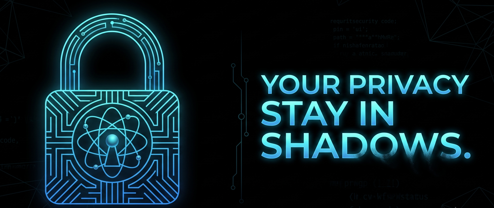
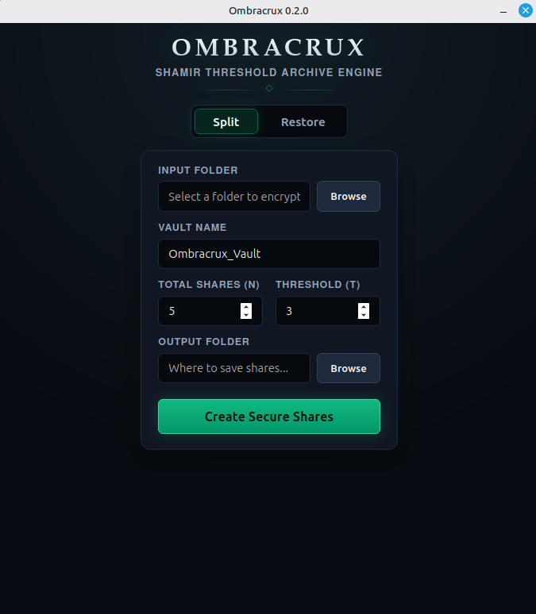

<p align="center">
  
</p>

<h1 align="center">OMBRACRUX</h1>

<p align="center">
  <strong>Shamir Threshold Archive Engine</strong><br>
  <em>Threshold-Bound Encrypted Archive Storage</em>
</p>

<p align="center">
  
  <a href="LICENSE"></a>
</p>

---

## Overview & Features

**Ombracrux** is an offline, cross-platform desktop application built with **Rust** and **Tauri** for threshold-based encrypted folder storage. It combines **Shamir's Secret Sharing ($T$-of-$N$)** over $GF(2^8)$ with chunk-indexed **XChaCha20-Poly1305** authenticated streaming encryption to split a folder into distributed cryptographic share files (`.ombracrx`).

To unlock and restore the original folder, a user-defined minimum number of shares (the **Threshold**, $T$) must be brought back together to reconstruct the 256-bit master encryption key—eliminating single points of failure without relying on cloud servers or external key-management services.

<p align="center">
  
</p>

* **Bounded-Memory Encryption Streaming:** During encryption, source directories are packaged on the fly through a bounded in-memory stream and piped directly into the cipher, writing encrypted share files without creating an unencrypted archive file on disk.
* **Authenticated Share Headers:** Every share header—including its Shamir key fragment, share index, threshold parameters, and bundle identifier—is authenticated via `HMAC-SHA256` using a subkey derived through `HKDF-SHA256`.
* **Chunk-Indexed AEAD & Truncation Defense:** Payload streams are encrypted in 1 MiB frames bound to deterministic chunk nonces, sequence-verified Associated Data (AAD), and a mandatory authenticated final closure record.
* **Staged Restoration & Best-Effort Rollback:** Share creation writes to hidden `.partial` files first and attempts best-effort rollback if publication fails mid-commit. Restoration unpacks decrypted files into a temporary staging folder (configured with `0700` permissions on Unix systems) and only renames it to the final output directory after the entire stream and final closure record pass cryptographic verification.
* **Offline Execution:** Contains no telemetry and makes no application-initiated network requests in the current implementation.

---

## User Guide

You do not need a background in cryptography to use Ombracrux. Think of Ombracrux as a digital vault whose key is shattered into multiple pieces (**Shares**).

### Core Concepts in Plain English
* **Shares ($N$ — Total Shares):** The total number of encrypted `.ombracrx` files Ombracrux will create from your folder (for example, `5` shares). You can store each share in a different place—such as a home PC, an external USB drive, a safe deposit box, or with a trusted family member.
* **Threshold ($T$):** The minimum number of shares required to unlock and recover your folder (for example, `3` out of `5`).
  * If your threshold is `3` out of `5`, **any 3 shares** can recover your files.
  * If a thief steals `1` or `2` of your shares, they cannot unlock your files.
  * If you lose `1` or `2` of your USB drives in a fire, you can still recover everything using the remaining `3` shares.
* **Vault Name:** A short label (using letters, numbers, underscores `_`, or hyphens `-`) used to name your generated share files, such as `Ombracrux_Vault.part1.ombracrx`.

---

### How to Protect a Folder (`Split` Tab)

1. **Select Your Input Folder:** Click **Browse** next to **Input Folder** and choose the folder containing the files you want to protect. *(Note: Symbolic links/shortcuts are not supported and will be rejected for safety.)*
2. **Name Your Vault:** Enter a **Vault Name** (for example, `Ombracrux_Vault`).
3. **Choose Your Shares & Threshold:**
   * Set **Total Shares (N)** to the total number of `.ombracrx` files you want to generate (between `2` and `255`).
   * Set **Threshold (T)** to the minimum number of shares required to unlock the vault later (between `1` and `N`).
4. **Select Your Output Folder:** Click **Browse** next to **Output Folder** and choose an existing folder outside your Input Folder where the `.ombracrx` share files should be saved.
5. **Create Secure Shares:** Click **Create Secure Shares**. Once the progress bar finishes and displays `"Encryption has been finished."`, distribute your `.ombracrx` files across separate, safe storage locations.

---

### How to Recover a Folder (`Restore` Tab)

1. **Switch to the Restore Tab:** Click **Restore** at the top of the window.
2. **Select Your Share Files:** Click **Browse** next to **Input Folder** and select at least $T$ (your threshold number) of the `.ombracrx` share files belonging to the same vault (hold `Ctrl` or `Shift` in the file picker to select multiple `.ombracrx` files at once).
3. **Select Your Output Folder:** Click **Browse** next to **Output Folder** and choose the destination folder where your recovered files should be placed.
4. **Recover & Unpack:** Click **Recover & Unpack**.
   * Ombracrux will verify the headers of all selected shares, reconstruct the master encryption key, and decrypt the archive stream into a new folder named `Ombracrux-Restored-<id>` inside your chosen Output Folder.
   * *Tip if a share file is damaged:* Ombracrux reads the encrypted data stream from the **first share file** in your selection. If that specific file suffered disk corruption, simply run **Restore** again with a different intact share selected first.

---

## Origins & Design

Ombracrux is an independent **Rust** and **Tauri** desktop implementation inspired by the threshold-based file recovery concept demonstrated by [Horcrux](https://github.com/jesseduffield/horcrux) (created by Jesse Duffield).

While sharing the conceptual workflow of threshold secret recovery, Ombracrux uses its own Rust architecture (`ombracrux-core`) and extends the concept with:
1. **Directory Streaming:** On-the-fly in-memory directory archiving (`archive.rs`) rather than single-file wrapping.
2. **Authenticated Streaming Format:** Per-share `HKDF-SHA256` + `HMAC-SHA256` header authentication (`format.rs`) and chunk-indexed `XChaCha20-Poly1305` AEAD framing (`crypto.rs`, `restore.rs`).
3. **Cryptographic Building Blocks:** Built on established Rust libraries including `sharks` for Shamir's Secret Sharing (`shares.rs`) alongside RustCrypto's `chacha20poly1305`, `hkdf`, `hmac`, `sha2`, and `zeroize` crates.
4. **Staged Desktop Workflow:** Modular workspace separation between the React/Tauri frontend and the `ombracrux-core` Rust crate, featuring real-time progress telemetry, staged restoration, and best-effort transaction rollback (`lib.rs`).

---

## Threat Models Ombracrux Deals With

Ombracrux is engineered to protect data at rest against specific physical, operational, and cryptographic risks:

### 1. Single-Point Physical Seizure or Device Theft
* **The Threat:** An adversary steals a single backup drive, compromises one storage location, or seizes fewer than $T$ share files.
* **How Ombracrux Mitigates It:** Shamir's Secret Sharing over $GF(2^8)$ provides information-theoretic secrecy for the key fragments alone when fewer than $T$ fragments are known. Because each `.ombracrx` file also contains the encrypted payload and an `HMAC-SHA256` header tag, the confidentiality and integrity of the complete vault artifact rely on the computational security of `XChaCha20-Poly1305`, `HKDF-SHA256`, and `HMAC-SHA256`.

### 2. Media Degradation or Partial Share Loss
* **The Threat:** One or more cold-storage drives suffer physical damage or loss over time.
* **How Ombracrux Mitigates It:** As long as at least $T$ compatible shares survive with valid headers—and the share selected first for payload reading contains an intact ciphertext stream—the archive can be reconstructed and verified.

### 3. Share Tampering, Cross-Bundle Splicing & Stream Truncation
* **The Threat:** An attacker modifies a share's index or Shamir fragment, swaps chunks between different vaults, truncates the end of a file, or appends trailing bytes.
* **How Ombracrux Mitigates It:**
  * **Header Integrity:** After reconstructing the candidate master key from the supplied Shamir fragments, Ombracrux verifies the constant-time `HMAC-SHA256` tag on **every supplied share header**, rejecting modified share indices, altered metadata, or mismatched shares before payload decryption begins.
  * **Stream Integrity:** Each encrypted chunk binds the format version, 16-byte `bundle_id`, chunk index, and plaintext length into the `XChaCha20-Poly1305` AAD, followed by a dedicated final closure record authenticating the total chunk count and total plaintext byte length. Any bit flip, chunk reordering, truncation, or trailing byte immediately aborts restoration and attempts to remove the temporary staging directory.

### 4. Unencrypted Archive Intermediates During Encryption
* **The Threat:** Traditional archive-then-encrypt workflows write a complete unencrypted archive to disk before encrypting it, leaving plaintext data behind in temporary storage.
* **How Ombracrux Mitigates It:** During the **Split** operation, source files are read directly into a bounded in-memory channel (holding at most 2 chunks in transit) and encrypted in memory before being written to the destination share files. *(Note: During the **Restore** operation, decrypted files are unpacked into a temporary staging directory on the destination disk prior to final stream verification.)*

### 5. Long-Term Symmetric Key Search (Quantum Search Vectors)
* **The Threat:** Adversaries capturing encrypted archives today to subject them to future quantum-assisted key search.
* **How Ombracrux Mitigates It:** Ombracrux does not rely on classical public-key cryptography (such as RSA or ECDH). It pairs Shamir threshold splitting with 256-bit symmetric `XChaCha20-Poly1305`, which provides an estimated ~128-bit theoretical security margin against generic quantum key search (Grover's algorithm). *Note: Ombracrux has not been formally validated or independently audited for post-quantum security.*

---

## Security Scope & Operational Boundaries

Users should understand the operational boundaries of the current implementation:

* **Payload Reading Scope During Recovery:** When $T$ or more shares are supplied for restoration, Ombracrux cryptographically authenticates the headers of **all supplied shares**. However, the encrypted archive payload is streamed and verified from the **first selected share**; payload bytes in the remaining supplied shares are not automatically tried as a fallback during the same restoration attempt.
* **Irrecoverable Loss Below the Threshold:** There are no backdoors, master recovery keys, or escrow mechanisms. If you configure a $3$-of-$5$ split and permanently lose $3$ shares, your data cannot be recovered.
* **Plaintext Staging During Restoration & Deletion Semantics:** During restoration, files are unpacked into a hidden `.ombracrx-restore-*.tmp` staging directory inside the output folder (created with `0700` permissions on Unix systems; Windows uses standard inherited directory ACLs) before the final closure record is reached. If verification fails, Ombracrux attempts to delete the staging directory via standard OS file removal (`remove_dir_all`), which unlinks files but does not guarantee physical block erasure on wear-leveled SSDs, and cannot run if the process is terminated abruptly (`SIGKILL` or power loss).
* **Multi-File Publication Boundaries:** Publishing multiple separate `.ombracrx` share files cannot be globally atomic at the OS filesystem level. While `ShareOutputTransaction` performs best-effort rollback of earlier shares if a later rename fails during commit, sudden power loss mid-commit can leave a partial set of shares on disk.
* **Compromised Host OS & Webview Configuration (Out of Scope):** Ombracrux assumes the host operating system is trusted during split and restore operations. It cannot defend against active kernel rootkits, memory scrapers, or keyloggers on a compromised machine. In addition, the Tauri webview currently operates with `csp: null` and has not undergone a dedicated webview-hardening or independent cryptographic audit.

---

## Storage Overhead & System Requirements

### Storage Footprint
Because Ombracrux duplicates the encrypted archive stream across each generated share so that any $T$ shares can reconstruct the vault:
* **No Source Folder Overhead:** Encryption writes no temporary files into your source directory.
* **Destination Space Required:** If your directory produces a packaged archive stream of size $A$ (which includes file contents plus TAR directory metadata headers and 512-byte block padding, especially noticeable with many small files), splitting into $N$ shares requires approximately **$N \times A$** bytes of free space in the output folder, plus framing overhead (20 bytes per 1 MiB chunk plus share header and final-record bytes).

### Minimum Specifications
* **OS:** Linux (Ubuntu 22.04+, Linux Mint, Debian, Fedora), Windows 10/11 (64-bit), macOS 11+
* **Processor:** 64-bit dual-core CPU
* **Memory:** 4 GB RAM (encryption and decryption stream in bounded 1 MiB chunks)

---

## Download & Installation

Download the latest installers from the [Releases Page](https://github.com/ABiswasDev/Ombracrux/releases):

* **Linux:** `.deb`, `.rpm`, or `.AppImage`
* **Windows:** `.msi` or `.exe` installer
* **macOS:** `.dmg` disk image

---

## Developer Guide: Building & Testing from Source

Ombracrux uses a Tauri workspace connecting a React/TypeScript frontend with the `ombracrux-core` Rust crate.

### 1. Prerequisites
* **Node.js:** v20+ and `npm`
* **Rust:** Stable toolchain (`rustup`, `cargo`, `rustfmt`)
* **Linux System Dependencies (Ubuntu / Mint / Debian):**
  ```bash
  sudo apt update
  sudo apt install -y libwebkit2gtk-4.1-dev libgtk-3-dev build-essential curl wget file libxdo-dev libssl-dev libayatana-appindicator3-dev librsvg2-dev patchelf pkg-config libglib2.0-dev
  ```

### 2. Local Development
```bash
git clone https://github.com/ABiswasDev/Ombracrux.git
cd Ombracrux
npm ci
npm run tauri dev
```

### 3. Running Automated Checks & Tests
All formatting, workspace compilation, and automated unit/integration tests are executed from `src-tauri`:
```bash
cd src-tauri
cargo fmt --all -- --check
cargo check --workspace
cargo test --workspace
```

### 4. Building Production Installers
```bash
npm run tauri build
```

---

## Project Structure

```plaintext
ombracrux/
├── .github/workflows/
│   ├── ci.yml                # Automated formatting, check, and test verification on push/PR
│   └── release.yml           # Cross-platform release bundler triggered on version tags
├── LICENSE                   # Verbatim PolyForm Noncommercial License 1.0.0 terms
├── TRADEMARKS.md             # Trademark and branding reservation policy
├── package.json              # Frontend dependencies and build scripts
├── src/                      # Frontend Presentation Layer (React / TypeScript)
│   ├── App.tsx               # Fixed-viewport UI, state management, and Tauri IPC bridge
│   ├── App.css               # Obsidian & Spectral Emerald theme styling
│   └── main.tsx              # React DOM entry point
└── src-tauri/                # Rust Backend & Cryptographic Workspace
    ├── Cargo.toml            # Tauri application manifest
    ├── tauri.conf.json       # Window geometry and bundler configuration
    ├── src/
    │   ├── lib.rs            # IPC commands, path validation, and ShareOutputTransaction
    │   └── main.rs           # Application binary entry point
    └── crates/core/          # Cryptographic Engine (ombracrux-core)
        ├── Cargo.toml        # Isolated crypto dependencies (sharks, chacha20poly1305, hkdf, hmac)
        ├── src/
        │   ├── archive.rs    # Bounded-memory ChannelWriter TAR streaming producer
        │   ├── crypto.rs     # Chunk-indexed XChaCha20-Poly1305 encryption pipeline
        │   ├── format.rs     # Binary share header serialization & HMAC-SHA256 authentication
        │   ├── restore.rs    # Authenticated stream decryption & staged directory unpacking
        │   ├── shares.rs     # Shamir's Secret Sharing (GF(2^8)) key split & recovery
        │   └── split.rs      # High-level directory split orchestrator
        └── tests/
            └── streaming.rs  # End-to-end tampering, truncation, and restoration test suite
```

---

## Author & Maintainer

* **Abhishek Biswas** — *AI Systems Strategist & Security Architect* — [@ABiswasDev](https://github.com/ABiswasDev)

---

## License & Trademark Notice

### Source-Available License (PolyForm Noncommercial 1.0.0)
Ombracrux is source-available software licensed under the **[PolyForm Noncommercial License 1.0.0](LICENSE)**.

* **Permitted Noncommercial Use:** Personal use, security research, academic study, non-commercial experimentation, and use by qualifying charitable, educational, public research, and government organizations are permitted under the terms of the [LICENSE](LICENSE).
* **Commercial Use Prohibited:** Any commercial use—including selling, trading, licensing, bundling into commercial products, or using the software in a commercial business operation—is strictly prohibited under the PolyForm Noncommercial License and requires a separate written commercial license agreement from the author.

Required Notice: Copyright (c) 2026 Abhishek Biswas (https://github.com/ABiswasDev/Ombracrux)

### Trademark & Branding Policy
The names **"Ombracrux"**, **"Ombracrypt"**, **"Ombraveil"**, and all associated logos, emblems, and visual identifiers are proprietary trademarks of **Abhishek Biswas**. While the source code is made available under the PolyForm Noncommercial License 1.0.0, **no license or right to use these trademarks is granted**:

* **No Rebranding as Official Releases:** You may not distribute modified versions or forks of this software under the names "Ombracrux", "Ombracrypt", or "Ombraveil", or use confusingly similar names or logos that imply endorsement by or affiliation with Abhishek Biswas.
* **Attribution Required on Forks:** Any permitted non-commercial fork or modified redistribution must retain the `Required Notice` above and clearly state that it is an unofficial modification.